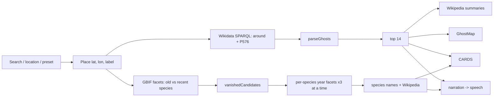

# Design: Ghosts of Here

## Overview

## Lost places query
`wikibase:around` within 1 km, `wdt:P576` required; optional P571, P18, P31 label, enwiki sitelink; English (then multilingual) labels; up to 600 rows ordered by distance. `parseGhosts` drops rows without a label, with a bare QID label, or with an unparseable point, and merges duplicates: earliest inception, latest end, all type labels.

## Vanished wildlife
1. Facet `speciesKey` for records 1800–1960 (top 300) and 1990–now (top 5000) within 5 km.
2. Candidates: ≥ 3 old records, absent from the recent facet, top 12 by count.
3. For each candidate (3 at a time): facet `year` for the exact last year (dropping any with a year ≥ 1990 that the facet limit hid), GBIF species name, Wikipedia summary by scientific name.
4. Keep 6, preferring species with an article and a common name.

## Map
Static Web Mercator view, 640 × 440 logical pixels, zoom chosen so the 1 km radius fits. Standard OSM tiles with a CSS invert/hue filter for a night look. `spread()` nudges overlapping markers along a spiral until they're at least 20 px apart.

## Tour
Intro → up to 7 ghosts → up to 2 species → outro. `speak()` resolves on `onend`, on error, or after reading time + 4 s (some engines never fire `onend`); "captions only" waits reading time (400 ms per word, ≥ 2.5 s). An AbortController ends the tour instantly.

## Correctness properties

| # | Property | Requirement |
| --- | --- | --- |
| P1 | `parseYear` round-trips any non-zero year and rejects unknown values | 2.3 |
| P2 | `lifespan` and every narration line never contain null/NaN/undefined; ghost lines name the place | 4.6 |
| P3 | `parseGhosts` returns one ghost per item, sorted nearest first, merging dates and types | 2.1, 2.2 |
| P4 | Only Commons file paths become thumbnails | 2.3 |
| P5 | Wildlife candidates: ≥ 3 old records, never recent, ordered by count, ≤ 12 | 3.1 |
| P6 | `sentences` returns a prefix, never more than asked, never splits decimals/initials/abbreviations | 2.3 |
| P7 | `mapLimit` keeps order and never exceeds the limit | 5.3 |
| P8 | `spread` leaves markers ≥ 20 px apart and near their true spot | 2.4 |
| P9 | Distance is symmetric; bearing in [0, 360); projection within 1% of real distance | 2.3, 2.4 |
